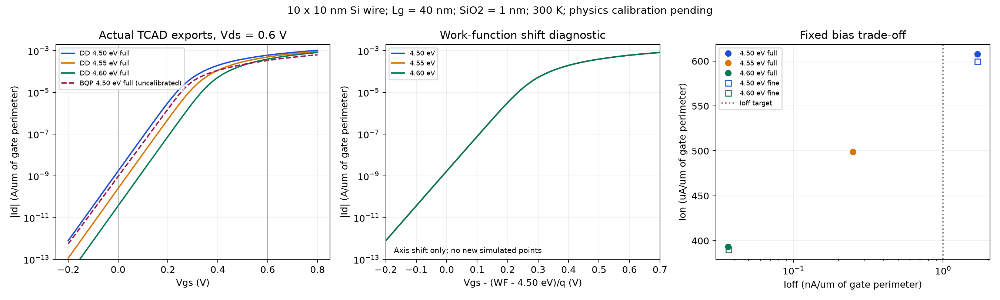

# GAA 전체 TCAD 결과와 다음 연구 방향

작성일: 2026-11-24. **최신 원격 관측: 2026-11-24 11:17:49 KST.**

**현재 가장 강한 결과는 4.60 eV 고전 DD 소자의 공학 목표 충족과 양방향 full–fine 메시 수렴이다. 그러나 일함수에 따른 변화는 거의 전적으로 Id–Vg의 수평 이동으로 설명된다. 따라서 다음 연구는 ‘일함수를 더 조절하여 전류비를 올리는 연구’보다 ‘일함수로 보상할 수 없는 공간적 비균일성의 영향’을 구분하는 방향이 적합하다.**

이 보고서에서 ‘통과’는 수치 검사·공학 목표·메시 비교를 각각 가리킨다. 실제 소자 측정에 맞춘 물리 보정은 아직 완료되지 않았다. 세계 최초 또는 문헌 전체에 대한 비중복을 확정한 보고서가 아니다.

## 1. 조사 범위와 출처

요청을 실행한 [프롬프트](연구계획/전체결과_후속실험_연구주제_실행프롬프트_20261124.md)를 먼저 저장했다. 시작 브랜치는 `main`; README·agent 관련 기존 미커밋 변경이 있었으며 보존했다. 연구 설계와 사전 목표, 전체 수집 폴더, 실제 덱, 기존 검증기와 최신 원시 로그를 조사했다.

- 최초 목록화 시 `.local/collected`에는 233개 수집 폴더가 있었다. 이 중 통합 presentation snapshot은 109개, 나머지 수집은 124개였다. 같은 실행을 여러 차례 회수한 폴더, 통신·설치·상태 조회가 포함되므로 이를 독립 TCAD 실험 233개로 세지 않는다.
- 새 읽기 전용 snapshot `gaa_research_review_20261124T021733Z`를 등록 agent로 회수했다. 신규 simulator 실행은 0개다. 다른 사용자의 실행, STOB, 기존 scheduler를 변경하지 않았다.
- 최신 snapshot의 manifest **1,064개 파일**과 초기 실행·모델 조회 9개 수집본의 **139개 파일**을 SHA-256으로 다시 대조했다. 불일치 0개다. 이 수는 파일 수이며 소자 수가 아니다.
- 최신 4개 DAG 실행 계열의 작업 **60개 전부**를 상태·입력·검증 기록으로 목록화했다. 성공 중 smoke를 제외한 **30개 조건**은 native 로그와 단자 export에서 지표를 재계산했다. 저장 지표 및 실행/종료 검사와 일치했다. screen 16개와 full/fine 14개가 포함된다.
- 명시 바이어스 계열의 성공 9개 조건은 적응형 중간점까지 포함해 원시 바이어스·export·KCL을 다시 검사했다. 보간으로 누락점을 만들지 않았다. 각 fine의 역방향 메시 비교도 별도로 재계산했다.
- DAG smoke 7개와 초기의 정상 종료 smoke 2개도 native/export·실제 Vds·KCL을 재검사했다. 짧은 low Vds 곡선이므로 전체 Ion/Ioff 성능으로 사용하지 않았다. [짧은 시험 검증](../검증/전체연구검토_20261124/smoke_checks.json).

전체 개별 조건은 [실행전체목록](../검증/전체연구검토_20261124/실행전체목록.md), [CSV](../검증/전체연구검토_20261124/case_ledger.csv), [전체 지표](../검증/전체연구검토_20261124/최신재계산/metrics.csv), [감사 JSON](../검증/전체연구검토_20261124/최신재계산/audit.json), [추가 검증과 추세](../검증/전체연구검토_20261124/supplemental_validation.json)에 있다. 문서의 수치 기준 시각 이후 상태는 이 보고서에서 확정하지 않는다.

## 2. 실제로 계산한 소자

| 항목 | 현재 기준 | 해석 범위 |
| --- | --- | --- |
| 구조 | 단일 직사각 Si 나노와이어, 실제 3D | 적층 nanosheet·CFET·회로 결과 없음 |
| 채널 | 10 × 10 nm, Lg 40 nm | 치수 sweep의 유효 성능 결과 없음 |
| 절연막 | SiO2 1 nm | high-k 적층이나 실제 ALD 공정 재현 아님 |
| 소스/드레인 | 연장 각 20 nm, n형 1e20 cm^-3 | 이상적 급격한 접합·접촉 가정 |
| 채널 도핑 | p형 1e16 cm^-3 | 공정 보정 없음 |
| 온도 | 300 K | 온도 의존성 결과 없음 |
| 주 바이어스 | Vds 0.05/0.6 V, Vgs −0.2~0.8 V, 목표 간격 0.02 V | Ion: Vgs=Vds=0.6 V; Ioff: Vgs=0/Vds=0.6 V |
| 모델 | FERMI, CONMOB, FLDMOB, SRH, BGN의 DD | 계면 이동도·고전계 수송·누설의 실험 보정 없음 |
| 양자 민감도 | BQP.N, gamma 1.4, alpha 0.3 | 설치 예제 계수 사용; 이 소자에 대한 보정 아님 |
| 설치 버전 기록 | ATLAS 5.34.0.R, DevEdit 2.8.26.R, DeckBuild 5.2.17.R | 실제 로그/초기 환경 기록 기준 |

둘레 P=2(W+H)=40 nm=0.04 um. `I[A/um]=I_wire[A]/0.04`이다. 예를 들어 390.100 uA/um는 단일 소자 390.100 uA가 아니라 **15.6040 uA/wire**다.

성능 목표는 [최초 설계](../연구/01_GAA_IdVg/md/설계와목표.md)를 유지했다. Ion≥100 uA/um, Ioff≤1 nA/um, Ion/Ioff≥1e6, low Vth 0.1~0.5 V, SS 60~90 mV/dec, DIBL 0~50 mV/V다. SS의 고정 전류창은 1e-10~1e-8 A/um, Vth는 100 nA/um 일정전류 방식이다.

## 3. 실행의 전체 흐름

### 3.1 초기 명령·3D 생성·짧은 DC 시험

| 실행 | 실제 결과 | 결론 |
| --- | --- | --- |
| preflight bg01 | 도구/환경 조회, simulator 미실행 | 실행 환경 확인 |
| smoke r01 | 0.521초, 코드 1, DeckBuild 옵션 오류 | 소자 해석 전 실패 |
| smoke r02 | 241.131초, 코드 15/timeout, 구조·평형 출력, Id–Vg 없음 | 3D 생성·평형 관측에 한정 |
| smoke r03 | 241.352초, 코드 0, ATLAS 정상 종료, low Vds 5점 | 짧은 게이트 전환 확인; 성능 판정 불가 |
| full r01 / r02 | 각각 약 2,401초에서 과거 제한 종료, 코드 15/143 | 전체 곡선 없음 |
| parallel 20261116T062844Z | smoke 245.136초/5점 정상 종료, coarse·fine 각 약 4,801초 제한 종료 | 병렬화 자체가 성능 검증을 보장하지 않음 |
| modelhints r01 / r02 | 설치 모델/예제 조회 | 별도 소자 성능 실험으로 세지 않음 |

r03와 parallel smoke의 과거 status에는 `EXECUTION_FAILED`가 남아 있다. 당시 분류기가 `SFLM Transport Error: No Error`를 fatal로 오분류했다. 원본 상태를 바꾸지 않고, 코드 0·정상 종료·실제 5점 출력이라는 증거를 따로 보고한다. 통신 경고가 없었다는 뜻은 아니다. 초기 8개 simulator 호출 기록은 아래 60개 DAG 작업과 구분한다. parallel 상위 상태와 하위 상태는 같은 실행의 중복 기록이다.

초기에 존재했던 240/2,400/4,800초 제한은 과거 실패의 배경이다. **향후 계산·중계·agent에 예정 만료를 두지 않는 최신 규칙을 유지한다.**

### 3.2 DAG 작업 60개

| 실행 ID | 계획 | 수치 게이트 성공 | 실패 | 보류 | 실행 중 | 대기 |
| --- | ---: | ---: | ---: | ---: | ---: | ---: |
| gaa_overnight_20261116T080149Z | 34 | 24 | 8 | 2 | 0 | 0 |
| gaa_autonomous_20261117T064609Z | 2 | 0 | 2 | 0 | 0 | 0 |
| gaa_continuation_20261118T053927Z | 12 | 4 | 4 | 4 | 0 | 0 |
| gaa_continuation_explicit_20261120T063127Z | 12 | 9 | 1 | 0 | 1 | 1 |
| **합계** | **60** | **37** | **15** | **6** | **1** | **1** |

37개 성공의 구성은 smoke 7, screen 16, full 11, fine 3이다. 초기화/선형해법/재취득 경로의 반복이 있으므로 서로 다른 최종 소자 37개라는 뜻은 아니다. 사전 성능 목표를 만족하지 못해도 수치 게이트를 통과하면 scheduler의 `SUCCEEDED`가 될 수 있다.

처음 3계열은 최신 관측에서 해당 scheduler PID와 소속 live process가 없었다. 명시 바이어스 계열은 scheduler와 소속 프로세스가 존재하며 BQP full이 실행 중이다. heartbeat와 TCAD 수렴을 구분한다.

## 4. 대표 성능 결과

full은 성능용 기본 메시, fine은 그보다 세밀한 메시다. screen은 진단용 완화 메시이며 아래 최종 비교에는 포함하지 않았다. DD는 비교가 쉬운 최신 명시 바이어스 결과를 우선했고, BQP는 완결된 기존 full을 별도로 실었다.

| 모델·일함수·메시 | Ion uA/um | Ioff nA/um | Ion/Ioff | low Vth V | SS low/high mV/dec | DIBL mV/V | 공학 목표·추가 판단 |
| --- | ---: | ---: | ---: | ---: | --- | ---: | --- |
| DD 4.50 full | 607.717 | 1.69654 | 3.58209e5 | 0.112676 | 60.1793 / 60.0628 | 11.0853 | Ioff·비율 미달 |
| DD 4.50 fine | 599.741 | 1.70061 | 3.52662e5 | 0.112626 | 60.1794 / 60.0643 | 11.0961 | 메시 통과, Ioff·비율 미달 |
| DD 4.55 full | 499.041 | 0.249371 | 2.00120e6 | 0.162672 | 60.1854 / 60.0584 | 11.0846 | 공학 목표 충족, 전체 fine 미확보 |
| DD 4.60 full | 393.365 | 0.0366020 | 1.07471e7 | 0.212676 | 60.1793 / 60.0628 | 11.0853 | 공학 목표 충족 |
| **DD 4.60 fine** | **390.100** | **0.0366920** | **1.06318e7** | **0.212626** | **60.1794 / 60.0643** | **11.0961** | **공학 목표·왕복·양방향 메시 통과** |
| 기존 BQP 4.50 full | 341.224 | 0.933067 | 3.65701e5 | 0.137347 | 61.7307 / 61.8827 | 21.4248 | 비율 미달, 미보정·fine 미확보 |

4.60 fine의 단일 wire Ion은 **1.56040189e-5 A**, Ioff는 **1.46767935e-12 A**다. 4.55 full은 각각 1.99616281e-5 A, 9.97484541e-12 A다.

기존 full의 중복 확인값도 누락하지 않았다. 4.50 DD의 eq_bicgst/eq_direct/eq_default/bias_direct full은 Ion 약607.715~607.716 uA/um, 기존 4.55 full은499.039, 4.60 full은393.363 uA/um였다. 새 취득값과 매우 가깝다. 기존 full과 명시 바이어스 full은 독립 공정 샘플이 아니라 같은 모델의 수치 재현 검사다. 30개 재계산값 전부는 연결한 metrics.csv에 보존했다.

### 4.1 메시와 왕복 검증에서 확인한 것

- 기존 4.50 full→fine: high Ion 1.31246%, Ioff 0.23992%, Vth 0.05613 mV, SS 0.00153 mV/dec 차이. low/high 8항목 통과.
- 최신 4.50과4.60 full→fine은 forward와reverse 모두 메시 허용값을 만족했다. 최신4.60 high의 변화는 Ion **0.82978%**, Ioff **0.24587%**, Vth **0.05613 mV**, SS **0.00153 mV/dec**다.
- 최신4.60 fine은 forward와reverse 모두 공학 목표를 만족했다. 왕복 Vth 차이는 low5.35e-9 V/high8.17e-9 V 수준이다. 트랩 모델/동역학이 없는 수치 경로 일치이며 물리적 히스테리시스 검증은 아니다.
- 4.60 fine high forward 원시 로그에는 적응형 −0.11 V가 추가되어52점이다. 51개 목표점은 모두 존재한다. 11/20에 미리 정한 명시 바이어스 규칙에 따라 **추가점까지 바이어스·KCL 검사**한 뒤 원본 목표행만 선택했다. 과거의 ‘정확히51점’ 실패 판정을 사후 변경한 것이 아니다. audit.json의 일반 `expected_gate_grid_pass=false`만 보면 이 새 취득 규칙을 잘못 읽을 수 있다. [추가 검증 JSON](../검증/전체연구검토_20261124/supplemental_validation.json)의 `explicit_raw_checks`를 함께 본다.

## 5. 경향과 과학적 해석



### 5.1 일함수 0.10 eV 증가의 대부분은 문턱전압 이동이다

최신 full에서 4.50→4.60 eV로 바꾸면 low Vth는 **정확히0.100000 V** 증가한다. 고정 바이어스 Ion은35.2718% 감소하고, Ioff는46.3511분의1이 된다. SS와 DIBL은 사실상 변하지 않는다. log10(Ioff)의 기울기는 약−16.6606 decade/eV로, 약60 mV/dec의 문턱 아래 기울기와 일관된다.

이번에 다음 검사를 추가했다. 4.60 곡선의 실제 Vgs에서0.10 V를 뺀 점을 4.50 곡선의 실제 점과 짝지었다. 두 전압이 원래0.02 V grid에 있으므로 보간하지 않았다. 기준 전류창1e-10~1e-3 A/um 내 각 bias/mesh의39쌍을 비교했다.

| 비교 | 최대 상대 전류차 |
| --- | ---: |
| low full | 1.83e-9 |
| high full | 출력 정밀도 내0 |
| low fine | 8.48e-9 |
| high fine | 1.33e-7 |

즉 현재 이상적 DD 모델에서 일함수 변경은 거의 순수한 전압축 이동이다. **누설을 줄였다는 사실은 맞지만, 채널의 고유 이동도·전기장 제어·같은 overdrive의 구동력을 개선했다고 주장할 근거는 없다.** 실제 GAA 연구에서도 gate work function의 변화가 전달곡선을 이동시키는 효과와 도핑·접촉 효과를 분리한다. [실험 비교를 포함한 3D TCAD 연구](https://www.sciencedirect.com/science/article/pii/S0038110122003239).

4.60 eV를 ‘최적’이라고 부를 수도 없다. 조사한 세 일함수 중 누설 여유가 크고 검증이 가장 완결된 조건이지만, 4.55 eV의 더 큰 Ion, 실제 공정 분산, 실제 gate 누설, 회로 목표를 포함한 최적화는 수행하지 않았다.

### 5.2 BQP 영향은 크지만 실제 양자 효과량으로 확정할 수는 없다

완결된 기존 full끼리 비교하면 BQP 사용 시 Ion−43.8513%, Ioff−45.0018%, low Vth+24.6710 mV, DIBL+10.3395 mV/V다. 단순 일함수 이동과 달리 SS와 DIBL도 달라졌다. 다만 계수는 다른 설치 예제에서 가져왔고, 현재 소자의 전하·C–V·실험값에 맞추지 않았다. 따라서 수치는 **미보정 모델 선택에 대한 민감도**다.

Silvaco는 3D BQP의 전하분포/정전용량 계산을 설명하며, 보정에는 전하·C–V 비교와 적절한 기준 해석이 필요하다. 구판 ATLAS 매뉴얼의 S–P 구현은 양자 구속 한 방향이라는 제약도 명시한다. 10×10 nm 단면의 두 횡방향 구속 검증을 그1D 비교만으로 완료했다고 할 수 없다. [Silvaco 3D BQP](https://silvaco.com/simulation-standard/comparison-of-3-dimensional-quantum-effects-in-nano-devices-using-the-atlas-3d-bqp-model/), [제조사 매뉴얼 대학 보관본 §13.4.1](https://cfd.rit.edu/products/manuals/Silvaco/atlas_users.pdf).

### 5.3 아직 관측하지 않은 추세

Lg·단면·산화막·온도·spacer·interface trap 변화의 검증된 sweep은 없다. 단일 wire 결과로 적층 nanosheet, SRAM/DRAM, AC 속도, 실제 소비전력, 수명, 양산성 또는 공정비 절감의 추세를 만들 수 없다. gate 전류가0으로 나와도 해당 터널링 모델이 꺼져 있으면 실제 gate 누설의 검증이 아니다.

## 6. 실패와 현재 실행을 어떻게 읽어야 하는가

| 계열·조건 | 실제 근거 | 후속 판단 |
| --- | --- | --- |
| 기존 bias_bicgst/full 등 | 코드0·정상 종료여도 native Vds가 목표 미달 또는 sweep 불완전 | 성공 지표로 사용 불가 |
| direct fine2개 | `Unable to allocate memory`, 코드1 | 메모리 오류 확인; 무관한코드11 실패에 원인 전용 금지 |
| eq_default fine | 코드11, 필수 출력 미확보 | 구체 원인 미확정 |
| 기존 wf4p55/wf4p6 fine | low Vds0, high 약0.490046/0.340703 V | 이름에 fine이 있어도 유효 비교 아님 |
| autonomous ramp0022개 | 4.55 low≈0.043318 V/1점·high없음; 4.60 low0/high0.161 V | ramp 축소만으로 해결되지 않음 |
| 이전 continuation4.50/4.60 full | 목표점은 존재했으나 reverse의 추가 적응형 점으로 당시 고정 grid검사 실패 | 당시 실패 유지, 새 명시 취득 실험과 구분 |
| 이전 continuation4.55 fine | low forward−0.20 V누락; high 양방향은유효 | high 부분 결과만 진단자료로 보존 |
| 이전 continuation BQP screen | high Vds≈0.440008 V | full/fine 보류 |
| 새 explicit4.55 fine | 실행 코드143, 약7.33초 후worker종료, ATLAS 정상종료·native곡선 없음 | 중지/신호의 주체와 사유는 미확정; 새ID의 동일덱 재현이 우선 |
| 새 explicit BQP full | RUNNING, 경과 약303,154.5초=84.21시간, 저장 low native Vds0; low reverse7점, 반복 수렴 경고 | **원하는0.05/0.6 V 성능으로 사용할 수 없음.** 프로세스 생존과 정상 수렴을 구분 |
| 새 explicit BQP fine | PENDING | 실제 계산 결과 없음 |

이전4.55 fine의 유효 high 부분값: Ion494.029590 uA/um, Ioff0.249979588 nA/um, 비율1.97628e6, high Vth0.156520 V, high SS60.0598 mV/dec. 전체 low/high·왕복을 만족하지 못했으므로4.55 fine 전체 통과로 올리지 않는다.

진행 중인 BQP를 이 분석 작업에서 중지·재시작하지 않았다. 경과시간이 길다는 이유로 임의 종료 기한을 만들지 않았다. 유효 바이어스 도달을 확인할 수 없어 종료 예상시간도 제시하지 않는다. 다음 실험 패키지에는 drain 단계가 실제로 실패하면 그 바이어스의 Id–Vg 취득으로 넘어가지 않는 과학적 실패 조건을 넣어야 한다. 계산시간 제한과 다른 조건이다.

## 7. 다음 실험의 우선순위

구체 변수·DAG·판정 기준은 [후속 실험 사전계획](연구계획/후속실험_사전계획_20261124.md)에 기록했다.

1. **기준 검증 보완:**4.55 fine 코드143의 원인 자료를 보존하고 동일 덱을 새ID에서 재현한다.4.60 fine을 현재의 수치 기준으로 채택하되 물리 보정 완료로 올리지 않는다. 구조 본체의 실제 계면 메시·전극·도핑을 판독한다.
2. **모델 신뢰성 확보:**BQP 바이어스 실패 경로를 단일 조건으로 분리한다. 계면 이동도·전하분포·양자 보정의 기준을 정하고 결과를 보기 전에 허용 오차를 고정한다. 구조가 다른 논문의 Ion에 맞춰 계수를 조정하지 않는다.
3. **주제의 최소 검증:**산화막 두께의 동일한 세 값을 source–middle–drain의 다른 순서로 배치한다. 일함수 하나만 조정하여 같은 Ioff로 맞춘 뒤 남는 SS·DIBL·Ion 차이를 측정한다. 평균 두께와 값의 분포를 통제하여 단순 두께 sweep과 구분한다.
4. **확대 여부 판정:**남는 차이가 수치 오차보다 크고 두 모델에서 해석이 유지되면 Lg/편차 크기의 보상 한계 지도를 만든다. 사라지면 개선 효과가 없다는 결론을 보존하고 확대를 보류한다.

최대3개 병렬, 각 선행 검증 직후 해당 후속을 시작하는 Python DAG, 계산·통신 예정 만료 없음,10분 파일 회수 원칙을 계획에 반영했다. 현재 요청으로 신규 TCAD 실험은 제출하지 않았다.

## 8. 제안 주제와 선택 이유

**우선 제안: 「동일 산화막 두께 분포를 갖는 사각 Si GAA 나노와이어에서 축방향 배열에 따른 일함수 보상 한계: 등누설 조건의 SS·DIBL·구동전류 잔차 지도」**

쉽게 말해, 산화막 두께의 평균과 편차가 같더라도 얇은 부분이 소스 쪽에 있는지 드레인 쪽에 있는지에 따라 같은 누설로 조정한 소자의 동작이 달라지는지를 묻는다. 현재 결과에서 일함수는 전달곡선을 이동시키는 데 매우 효과적이다. 그렇다면 **그 이동으로 없어지는 차이와 남는 차이를 분리하는 것**이 자연스러운 다음 질문이다.

새로운 GAA 구조나 비균일 산화막 자체를 최초 발명했다고 주장하지 않는다. 비균일 산화막 TFET, dual-metal/dielectric GAA, 단면 비균일 GAA는 이미 연구되었다. 이 제안의 차별성 후보는 **동일한 두께 값의 순열 대조군 + 단일 일함수의 등누설 보상 + 두 Vds에서의 잔차 + 모델/메시 불확실성 이상의 보상 불가능 영역**을 함께 정의하는 데 있다. [비균일 산화막 연구](https://www.sciencedirect.com/science/article/abs/pii/S1386947718305502), [dual-metal/dielectric GAA 연구](https://link.springer.com/article/10.1007/s00542-017-3446-1).

현재 DevEdit3D·ATLAS DD에서 기하 분할과 단일 gate work function을 이용해 검증할 수 있는 범위다. 다만 새3D 기하 생성기와 실제 parser/메시 smoke 검증이 필요하다. 양자/계면 이동도 보정 전 결과는 모델 내부의 전기적 민감도 연구로 한정한다. 실험 보정 후에야 실제 소자의 설계 허용도 주장으로 확장할 수 있다.

[연구주제·선행연구 비교](연구계획/연구주제와_선행연구검토_20261124.md)에 중복도가 높은 후보, 원문 확인 수준과 신규성 판단의 한계를 함께 기록했다. 현재 검색 범위에서 위 전체 비교 프로토콜과 정확히 같은 연구는 식별하지 못했지만, 유료 원문의 미열람 부분과 색인 누락이 있어 비중복 확정은 유보한다. 기존논문과 치수만 바꾸는 수준이라면 주제로 채택하지 않는다.

## 9. 재현과 산출물

```powershell
py -3.11 python/research_audit_20261124.py inventory
# request/collect는 이미 수행했다. 새 snapshot 필요 시에만 별도 실행한다.
py -3.11 python/automation/audit_results.py .local/collected/gaa_research_review_20261124T021733Z --out <존재하지_않는_새_감사폴더>
py -3.11 python/research_results_20261124.py --out <존재하지_않는_새_추가검증폴더> --figures <존재하지_않는_새_그림폴더>
py -3.11 python/verify_research_review_20261124.py
```

재계산은 보존 snapshot을 사용하므로 새 simulator 실행이 없다. `research_results`는 저장된 최신 감사 JSON을 입력으로 사용하며 출력 폴더는 새로 지정한다. 이번에 생성한 PNG/SVG를 직접 열어 축·범례·단위·잘림을 확인했다. 전압축을 이동한 그림은 재해석용 좌표 변환이며 새로운 TCAD 계산점이 아니다.

대용량`.str`의 실제 좌표·메시 본체 독립 검사는 이번 최신 소형 snapshot에 포함되지 않았다. 파일 해시와 구조보존 목록을 확인한 것과 본체 검증을 구분한다. 기존 원시 자료, 진행 중 실행, 기존 미커밋 변경은 보존했다.

문서 연결·수치 재현·원시 데이터 검사와 산출물 해시는 [최종 검증 기록](../검증/전체연구검토_20261124/final_validation.json)에 있다. 이는 실제 소자의 물리 교정 통과나 연구주제의 신규성 확정 기록이 아니다.
